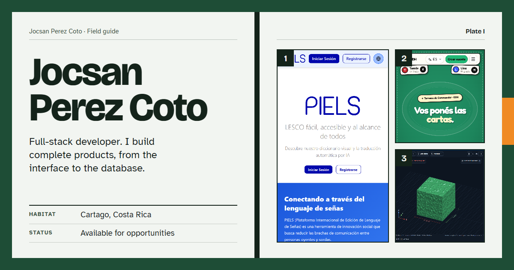

# Jocsan Perez Coto · Portfolio

Personal portfolio of a full-stack developer from Cartago, Costa Rica.

**Live site:** https://portfoliojocsanperez.vercel.app



## Concept

The site is designed as a Costa Rican field guide. Each section is an open two-page spread bound on a spine. Projects are numbered specimens with a classification table. Navigation is a set of orange thumb-index tabs on the edge of the book.

As you scroll, the right-hand page of each spread turns on the spine, driven by GSAP ScrollTrigger. Motion is reduced to static pages when the visitor's system asks for reduced motion.

## What's inside

| Section | Content |
|---|---|
| Plate I | Name, role, a short classification table, and links to projects and the CV |
| Plates II–IV | One spread per project: live screenshot, description, stack, and a link to the live site |
| Plate V | Index of technologies by layer, plus an interactive 3D model you can drag |
| Plate VI | Live GitHub profile data and the most starred repositories |
| Plate VII | Email, social links, CV download, and a contact form |

The page works in English and Spanish, and in light and dark themes. Both preferences are remembered in the browser.

## Featured projects

| Project | What it is | Link |
|---|---|---|
| PIELS | Sign language platform from Inclutec at the Tecnológico de Costa Rica. It turns Spanish text into Costa Rican Sign Language (LESCO) with an animated avatar. I work on it as a programmer in the team. | [inclutec.org](https://www.inclutec.org/welcome) |
| EDH Tournaments | Web app to organize Commander and TCG tournaments: players, rounds and live standings | [edh-tournaments.vercel.app](https://edh-tournaments.vercel.app/) |
| Web 3D Inclusiva | In-browser editor that adds printable tactile textures to 3D models | [web3dinclusiva.vercel.app](https://web3dinclusiva.vercel.app/) |

## Tech stack

| Layer | Technology |
|---|---|
| UI | React 18, Vite |
| Styling | Tailwind CSS v4 with CSS custom-property tokens |
| Motion | GSAP with ScrollTrigger and ScrollToPlugin |
| 3D | Three.js through React Three Fiber and drei, loaded lazily |
| Data | GitHub REST API |
| Contact form | EmailJS |
| Icons | lucide-react, react-icons |

## Run it locally

You need Node.js 20.19+ or 22.12+, which Vite 8 requires.

```bash
cd my-portfolio
npm install
npm run dev
```

The dev server runs on http://localhost:5173.

### Environment variables

The contact form needs EmailJS credentials. Create `my-portfolio/.env`:

```env
VITE_EMAILJS_SERVICE_ID=your_service_id
VITE_EMAILJS_TEMPLATE_ID=your_template_id
VITE_EMAILJS_PUBLIC_KEY=your_public_key
```

`VITE_GITHUB_TOKEN` is supported but optional. Leave it unset in production: any `VITE_` variable is bundled into the public JavaScript.

### Scripts

| Command | What it does |
|---|---|
| `npm run dev` | Start the dev server |
| `npm run build` | Build for production into `dist/` |
| `npm run preview` | Serve the production build locally |
| `npm run lint` | Run ESLint |

## Project structure

```
my-portfolio/
├── PRODUCT.md            # Audience, purpose and content rules
├── DESIGN.md             # Design system: tokens, type, components, motion
├── index.html            # Fonts, metadata, social preview
├── public/
│   ├── images/           # Project screenshots and profile photo
│   ├── PDF/              # CV
│   └── og-image.png      # Link preview image
└── src/
    ├── App.jsx           # Theme, language, section tracking, GSAP choreography
    ├── index.css         # Colour tokens for light and dark themes
    ├── data/data.js      # Profile, projects, technologies and socials
    ├── lib/              # GSAP setup, GitHub client, shared styles
    └── components/
        ├── Book.jsx          # Spread, Page, Folio, Chip, Classification, Figure
        ├── IndexTabs.jsx     # Thumb-index navigation and mobile tab bar
        ├── Hero.jsx          # Plate I
        ├── Projects.jsx      # Plates II–IV
        ├── Technologies.jsx  # Plate V
        ├── TechSphere.jsx    # The 3D model
        ├── GithubStats.jsx   # Plate VI
        ├── Contact.jsx       # Plate VII
        └── Controls.jsx      # Language and theme switches
```

## Editing content

Most content lives in `src/data/data.js`:

- `PROFILE_CONTENT` holds name, role, summary, location and email.
- `PROJECTS` holds each project's text in both languages, stack, link and screenshots.
- `TECH_GROUPS` holds the technologies shown in the index.
- `SOCIALS` and `CV_PATH` hold the contact links and the CV file.

## Deployment

The site deploys to Vercel from the `main` branch, with `my-portfolio` as the project's root directory.

---

Developed by Jocsan Pérez Coto, Tecnológico de Costa Rica.
